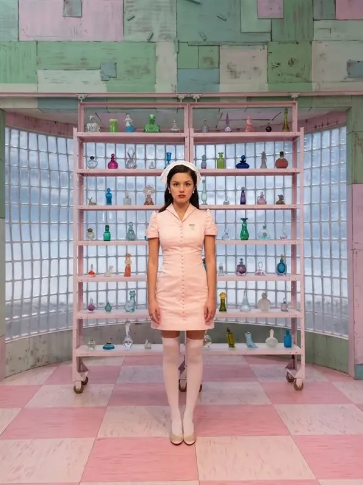

# 🩺 The Cure Run

**Endless runner 3D** con estética de hospital retro, inspirado en el videoclip de "the cure". Este repositorio contiene el **portal web** del juego y el build de Unity WebGL.

> *No dejes que apaguen tu corazón.*

🎮 **Jugar:** https://denistae.github.io/TheCureRun_Portal_GitHub/



## 📖 Resumen

Una enfermera corre sin fin por el pasillo de un hospital retro de tonos pastel. Antídotos, candelabros y corazones intentan frenarla: cada golpe le quita una vida. No existe la victoria, la meta es aguantar más que la vez anterior y superar tu propio récord antes de perder las tres vidas.

## ⚙️ Datos clave

| | |
|---|---|
| Género | Endless runner 3D |
| Vidas iniciales | 3 |
| Controles | ↑ saltar · ↓ agacharse / deslizarse |
| Subida de nivel | Cada 20 segundos |
| Récord inicial | 500 puntos |
| Invulnerabilidad | 1,5 s tras recibir un golpe |
| Motor | Unity (exportado a WebGL) |

## 📁 Estructura

```
index.html      Portal (historia, personaje, mecánicas, datos)
css/            Estilos del portal
js/             Interacciones del portal (menú, animaciones, contadores)
img/            Imágenes y recursos gráficos
fonts/          Tipografía Poppins
juego/          Build de Unity WebGL (index.html, Build, TemplateData)
```

> Nota: el build usa compresión **Gzip con Decompression Fallback** para funcionar en GitHub Pages. Los archivos de `juego/Build` son pesados (el mayor ronda los 28 MB), por eso se suben con Git / GitHub Desktop y no desde la web de GitHub.

